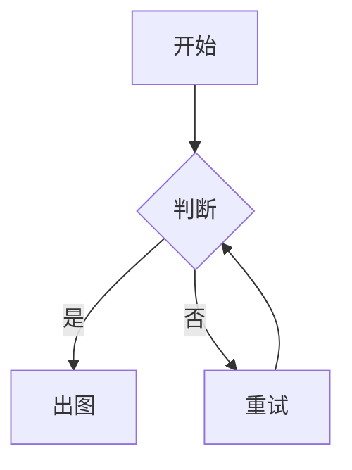

# Markdown image 手测样例

下面依次是 Mermaid、长代码块、长表格。用它检查三件事：图表出图、代码/表格与 PNG 同版式、预览字号 1:1。

## 流程图



## 长代码块

```dart
class PreviewPipeline {
  PreviewPipeline({required this.width});

  final double width;

  Future<void> load(String source) async {
    final blocks = parse(source);
    for (final block in blocks) {
      await block.prepare(width);
    }
  }
  // line 01: a long code block must be laid out in full, not folded to two lines.
  // line 02: a long code block must be laid out in full, not folded to two lines.
  // line 03: a long code block must be laid out in full, not folded to two lines.
  // line 04: a long code block must be laid out in full, not folded to two lines.
  // line 05: a long code block must be laid out in full, not folded to two lines.
  // line 06: a long code block must be laid out in full, not folded to two lines.
  // line 07: a long code block must be laid out in full, not folded to two lines.
  // line 08: a long code block must be laid out in full, not folded to two lines.
  // line 09: a long code block must be laid out in full, not folded to two lines.
  // line 10: a long code block must be laid out in full, not folded to two lines.
  // line 11: a long code block must be laid out in full, not folded to two lines.
  // line 12: a long code block must be laid out in full, not folded to two lines.
  // line 13: a long code block must be laid out in full, not folded to two lines.
  // line 14: a long code block must be laid out in full, not folded to two lines.
  // line 15: a long code block must be laid out in full, not folded to two lines.
  // line 16: a long code block must be laid out in full, not folded to two lines.
  // line 17: a long code block must be laid out in full, not folded to two lines.
  // line 18: a long code block must be laid out in full, not folded to two lines.
  // line 19: a long code block must be laid out in full, not folded to two lines.
  // line 20: a long code block must be laid out in full, not folded to two lines.
  // line 21: a long code block must be laid out in full, not folded to two lines.
  // line 22: a long code block must be laid out in full, not folded to two lines.
  // line 23: a long code block must be laid out in full, not folded to two lines.
  // line 24: a long code block must be laid out in full, not folded to two lines.
  // line 25: a long code block must be laid out in full, not folded to two lines.
  // line 26: a long code block must be laid out in full, not folded to two lines.
  // line 27: a long code block must be laid out in full, not folded to two lines.
  // line 28: a long code block must be laid out in full, not folded to two lines.
  // line 29: a long code block must be laid out in full, not folded to two lines.
  // line 30: a long code block must be laid out in full, not folded to two lines.
  // line 31: a long code block must be laid out in full, not folded to two lines.
  // line 32: a long code block must be laid out in full, not folded to two lines.
  // line 33: a long code block must be laid out in full, not folded to two lines.
}
```

## 长表格

| 序号 | 内容 |
| --- | --- |
| 1 | 第 1 行：预览与 PNG 应该显示同样的行数 |
| 2 | 第 2 行：预览与 PNG 应该显示同样的行数 |
| 3 | 第 3 行：预览与 PNG 应该显示同样的行数 |
| 4 | 第 4 行：预览与 PNG 应该显示同样的行数 |
| 5 | 第 5 行：预览与 PNG 应该显示同样的行数 |
| 6 | 第 6 行：预览与 PNG 应该显示同样的行数 |
| 7 | 第 7 行：预览与 PNG 应该显示同样的行数 |
| 8 | 第 8 行：预览与 PNG 应该显示同样的行数 |
| 9 | 第 9 行：预览与 PNG 应该显示同样的行数 |
| 10 | 第 10 行：预览与 PNG 应该显示同样的行数 |
| 11 | 第 11 行：预览与 PNG 应该显示同样的行数 |
| 12 | 第 12 行：预览与 PNG 应该显示同样的行数 |
| 13 | 第 13 行：预览与 PNG 应该显示同样的行数 |
| 14 | 第 14 行：预览与 PNG 应该显示同样的行数 |
| 15 | 第 15 行：预览与 PNG 应该显示同样的行数 |
| 16 | 第 16 行：预览与 PNG 应该显示同样的行数 |
| 17 | 第 17 行：预览与 PNG 应该显示同样的行数 |
| 18 | 第 18 行：预览与 PNG 应该显示同样的行数 |
| 19 | 第 19 行：预览与 PNG 应该显示同样的行数 |
| 20 | 第 20 行：预览与 PNG 应该显示同样的行数 |
| 21 | 第 21 行：预览与 PNG 应该显示同样的行数 |
| 22 | 第 22 行：预览与 PNG 应该显示同样的行数 |
| 23 | 第 23 行：预览与 PNG 应该显示同样的行数 |
| 24 | 第 24 行：预览与 PNG 应该显示同样的行数 |
| 25 | 第 25 行：预览与 PNG 应该显示同样的行数 |
| 26 | 第 26 行：预览与 PNG 应该显示同样的行数 |
| 27 | 第 27 行：预览与 PNG 应该显示同样的行数 |
| 28 | 第 28 行：预览与 PNG 应该显示同样的行数 |
| 29 | 第 29 行：预览与 PNG 应该显示同样的行数 |
| 30 | 第 30 行：预览与 PNG 应该显示同样的行数 |
| 31 | 第 31 行：预览与 PNG 应该显示同样的行数 |
| 32 | 第 32 行：预览与 PNG 应该显示同样的行数 |
| 33 | 第 33 行：预览与 PNG 应该显示同样的行数 |
| 34 | 第 34 行：预览与 PNG 应该显示同样的行数 |
| 35 | 第 35 行：预览与 PNG 应该显示同样的行数 |
| 36 | 第 36 行：预览与 PNG 应该显示同样的行数 |
| 37 | 第 37 行：预览与 PNG 应该显示同样的行数 |
| 38 | 第 38 行：预览与 PNG 应该显示同样的行数 |
| 39 | 第 39 行：预览与 PNG 应该显示同样的行数 |
| 40 | 第 40 行：预览与 PNG 应该显示同样的行数 |
| 41 | 第 41 行：预览与 PNG 应该显示同样的行数 |
| 42 | 第 42 行：预览与 PNG 应该显示同样的行数 |
| 43 | 第 43 行：预览与 PNG 应该显示同样的行数 |
| 44 | 第 44 行：预览与 PNG 应该显示同样的行数 |
| 45 | 第 45 行：预览与 PNG 应该显示同样的行数 |
| 46 | 第 46 行：预览与 PNG 应该显示同样的行数 |
| 47 | 第 47 行：预览与 PNG 应该显示同样的行数 |
| 48 | 第 48 行：预览与 PNG 应该显示同样的行数 |
| 49 | 第 49 行：预览与 PNG 应该显示同样的行数 |
| 50 | 第 50 行：预览与 PNG 应该显示同样的行数 |
